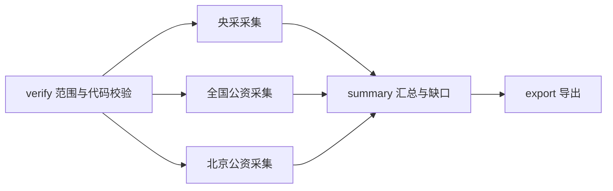

# ScrapingDataPipeline — 公开资料采集与研究工具库

面向研究人员和 GPT 的本地工具库，将公开网页、采购公告、机构名单及论文整理成可追溯的研究资料。主流程是：任务定义 → 来源发现 → 原文采集 → 证据提取 → 人工核验与项目归并 → JSON/CSV/工作簿/报告 → 想法树归档。

统一任务流水线目前支持 `health_deployment`（医疗装备、智慧医疗、健康服务、康养部署线索）。专用工具另支持医院采购、央采与公共资源交易平台、分省批次、机构六表、传播渠道 Mapping 和 DOI/arXiv 文献。采集、规则标签和事实核验分别记录；阶段完成不代表来源全量、项目落地或结论已核实。

## 阅读入口

| 文档 | 内容 |
| --- | --- |
| [架构与模块](#架构与模块) | 多 Agent 分工、Dagu 任务可视化、本地爬虫 Harness 与 RSIHub 自进化路线 |
| [采集器](#采集器) | 工具选择、异常处理、动态渲染、登录信息与会话处理 |
| [调研调用指南](docs/GPT_RESEARCH_GUIDE.md) / [AGENTS.md](AGENTS.md) | 任务范围、证据纪律、恢复与协作约定 |
| [命令与任务协议](docs/COMMANDS.md) | JSON 任务、参数、退出码与目录约定 |
| [数据字典](docs/DATA_DICTIONARY.md) | 资料、证据、项目、日期及状态口径 |
| [批次与工具使用手册](docs/USAGE_BATCHES.md) | 各采集链路的输入、命令、输出及依赖 |
| [2026-11-03 增补批次](docs/BATCHES_20261103.md) | 后续批次的可复用工具与范围 |
| [企业资料采集指南](COLLECTING_GUIDE.md) | 来源发现与分阶段采集 |
| [历史验证](docs/VALIDATION.md) / [变更记录](CHANGELOG.md) | 指定版本的验证记录，不是当前网站可用性承诺 |

本文命令默认在仓库根目录的 PowerShell 中执行。`<...>` 必须替换为实际路径或业务输入；历史截止日不自动代表今天。不同示例属于不同研究范围，不应一次执行全部示例。

## 架构与模块

SearchingAgent 是本项目的任务编排与调研工作流方向：上层研究人员/GPT 确定问题和范围，任务协议保存执行合同，采集器处理具体来源，核验与交付层保留证据。当前能力与代码位置如下；“已实现”指仓库有对应实现，不表示每个外部服务已经在当前机器配置或验收。

| 模块 | 职责与入口 | 当前状态 |
| --- | --- | --- |
| 多 Agent 协作 | 上层按来源、区域或采集/提取/核验角色分工，通过任务 JSON、原文、证据 ID 和收据交接；[任务协议](docs/COMMANDS.md)、[协作约定](AGENTS.md) | 可供外部多 Agent 宿主调用；本库未实现自主 Agent 团队调度、多模型协商或共享长期记忆 |
| 工作流编排与任务可视化 | Dagu 执行依赖图、队列及来源/区域并行步骤；[三平台编排](pipeline/research/tender_update.py)、[分省编排](pipeline/research/province_update.py) | 已实现 DAG 生成、启动、入队、状态与日志入口；需要本机 Dagu 等运行环境 |
| 本地爬虫 Harness（统一执行外壳） | [gateway.py](local-crawlers/gateway.py) → [job_runner.py](local-crawlers/job_runner.py) → [worker.py](local-crawlers/worker.py)，接入 browser-use、Skyvern、ScrapeGraphAI、Firecrawl | 已实现后端选择、参数与预算检查、独立进程、超时清理及结果查询；模型和后端需分别配置、验证 |
| 证据治理与可追溯交付 | [核验](pipeline/review.py)、[交付](pipeline/delivery.py)、[树渲染](scripts/idea_tree_writer.py)及 SHA256 归档 | 已实现来源与日期分离、显式项目归并、版本快照、失败留痕和离线校验 |
| 自进化模块 RSIHub | 失败证据 → 候选改进 → 固定样本评测 → 小范围验证 → 版本发布；[架构记录](idea-trees/searchingagent-dagu-bjxa-20261029/tree.json)、[实现边界](idea-trees/searchingagent-three-platforms-20261030/CODE_SUMMARY.md) | 属于规划中的独立实验/评测发布层；自动候选生成、自动改码、评测晋级与自动发布闭环尚未实现 |

### 多 Agent 协作与执行

可由支持多 Agent 的外部宿主组织“主控规划 → 分源采集 → 证据提取 → 独立核验 → 汇总交付”。这是建议的分工方式：主控固定研究范围、日期和任务 ID，各执行者返回原文位置、状态与缺口，核验者再显式关联 `evidence_ids`。不同研究范围使用独立任务目录，避免多个执行者同时改写同一任务或把候选、证据、项目重复计数。

仓库内实际并行执行的是受控采集步骤。三平台工作流在校验后启动三个来源步骤；分省工作流按区域隔离进程、目录、预算和锁，当前最多同时运行三个区域，并通过共享节流限制总请求速率。启动器初建的 `medical-tender-updates` 队列默认同时执行一个工作流，工作流内部再并行多个步骤；这与网关的任务并发设置是不同层级。[批次监督器](scripts/supervise_province_batches.py)可按前一批运行终态排队下一批，但步骤结束、请求重试和进程并发均不代表自主推理或多模型协商。

本地爬虫 Harness 提供另一组可选工具：简单 HTML 用 `fetch_page`，动态页面用 `render_page`，交互任务选择 browser-use/Skyvern，字段提取选择 ScrapeGraphAI，整站入口发现/采集选择 Firecrawl。先用 `crawler_status` 检查准备状态，再提交 `start_crawl` 并用 `job_status` 查询。每次选择一个后端，默认 `MAX_ACTIVE_JOBS=1`；四种后端不是同时协商的四个 Agent。这个网关尚未自动接入统一 `task/status/resume` 协议，结果进入研究证据流程仍需显式适配或导入。安装与能力边界见[本地爬虫说明](local-crawlers/README.txt)和[完整归档](idea-trees/local-crawler-agents-20261027/DETAILS.md)。

### 任务可视化与状态追踪

Dagu 提供任务网页。本库负责生成流程和业务收据，页面用于查看步骤依赖、运行记录、日志与队列。三平台的实际依赖关系如下；分省任务把三个来源节点替换为各区域节点。



用 [start-tender-update.ps1](scripts/start-tender-update.ps1) 或 [start-province-update.ps1](scripts/start-province-update.ps1) 提供 Python、Dagu、Node 和 Artifact 模块路径后启动；完整命令见[批次手册](docs/USAGE_BATCHES.md)。启动器会生成并校验 DAG、启动/复用服务并入队实际任务，默认端口 `8098`，`-Port` 可修改。`-NoBrowser` 仅不自动打开页面，不会把任务改成离线运行。历史医院案例中的 `8097` 是另一套运行实例。

不要拼接或假定运行编号，读取启动器写出的实际地址：

```powershell
# 将 <task_id> 替换为已经启动的三平台任务 ID；本命令只读取记录。
$launch = Get-Content 'outputs/tender-updates/<task_id>/launch.json' -Raw | ConvertFrom-Json
$launch.dashboard_url
```

| 查看对象 | 记录位置与解释 |
| --- | --- |
| Dagu 服务与任务网页 | `outputs/dagu-runtime/` 保存本机 DAG、运行状态和服务日志；启动器的 `launch.json` 保存实际任务页面地址 |
| 三平台/分省业务进度 | 任务目录中的 `request.json`、各来源或区域的 `progress.json`、分省 `region-progress.json`、汇总 `summary.json`；以本次返回路径为准 |
| 通用研究流水线 | `status --task-id ... --json` 与 `outputs/<task_id>/status.json`，含当前阶段、待处理阶段、锁和缺口 |
| 本地爬虫任务 | `job_status(job_id)` 与 `local-crawlers/runs/<job_id>/` 中的 `input.json`、`state.json`、`result.json`、`worker.log`；有些失败不会产出结果文件 |

页面上的运行状态与业务覆盖状态分别判断：部分来源失败时流程可以保留汇总和已有产物，Dagu 仍可显示失败；步骤成功也不能证明全历史覆盖。先核对 `partial`、未检索窗口、原文缺失和字段待核，再使用交付。分省的[实时快照工具](scripts/live_province_snapshot.py)读取进行中检查点，仅作观察，不能替代正式导出和验收；这些本机页面与状态文件不随 GitHub 克隆自动出现。

### 自进化模块：RSIHub 规划与现有基础

RSI 在这里指 Recursive Self-Improvement（递归自我改进）。项目计划把 RSIHub 作为独立的候选实验、评测与版本发布层，而不是让采集任务直接改写自身代码。当前仓库已具备可供这一层复用的基础：失败与缺口记录、原文及输入快照、离线回归用例、`code-revisions/` 代码哈希审计、不可变历史归档，以及修订后新建任务或按规则恢复的机制。已有自动重试、冷却和断点续采属于预设规则下的恢复能力。

规划中的改进流程为：

1. 从失败原文、解析错误或人工核验差异中形成可复现问题，保留原样本与原版本。
2. 在独立分支提出规则、解析器或采集策略候选，记录变更原因与预期影响。
3. 用与候选开发分开的固定样本和回归用例比较字段准确性、误收漏收、证据可追溯性与资源成本，避免只针对失败样本修补。
4. 在明确授权的范围内做小规模联网验证，确认访问约束、失败处理及旧功能没有退化，再经过审阅发布；不合格候选保留实验记录，不替换生产版本。

上述流程是路线图，当前没有可运行的 `RSIHub` 命令、自动评分晋级器或无人值守改码发布服务。维护者与 GPT 仍负责问题分析、实现、审阅和发布判断。[RSI 文献采集](literature/README.txt)用于研究相关方法与证据，不是本系统已具备自进化能力的证明。历史规划和未完成项见[SearchingAgent 进展](idea-trees/searchingagent-dagu-bjxa-20261029/PROGRESS.md)及[分省想法树](idea-trees/province-medical-digital-batches-20261030/tree.md)。

## 目录结构

```text
pipeline/
  cli.py, task_spec.py, task_runner.py  # 统一入口、请求校验、状态与恢复
  research/                           # 通用采集、采购解析、三平台与分省任务
  review.py, delivery.py               # 核验队列、项目台账与交付
scripts/                              # 医院/机构工具、启动器、导出与归档
  batches_20261103/                    # 后续批次工具，见专门说明
configs/                              # 来源、规则、名单种子、整理后的批次输入
tasks/                                # 版本 1 任务示例
tests/                                # 模拟网络、临时目录与解析回归
literature/                           # arXiv/DOI、全文导入、图片与文献库工具
local-crawlers/                       # 可选本地爬虫后端接入
docs/                                 # 用法、字段、历史验证与范围说明
idea-trees/<id>/                       # tree.json、生成的 tree.md、源码快照与清单
outputs/<task_id>/                     # 本机产物，默认不提交
repos/                                # 外部采集器检出，默认不提交
run-local.ps1                         # 运行时选择与 UTF-8 启动入口
requirements-research.txt              # 通用采集最小依赖
requirements-pipeline.txt              # Excel、浏览器及采集器适配扩展依赖
requirements-test.txt                  # 离线测试依赖，含图片与系统 TLS 测试
environment.yml                       # Python 3.11 的 Conda 环境声明
```

`configs/*reports*.json` 等是特定批次的整理输入，不是程序实时采集结果；人工结论仍须结合来源阅读。`idea-trees/*/artifacts/` 是历史参考副本，当前执行代码以 `pipeline/`、`scripts/`、`literature/` 为准。

## 环境与安装

核心要求 Python 3.10+；Conda 声明使用 3.11。Windows/PowerShell 是主要验证环境。纯 Python 核心可在其他系统调用 `python -B -m pipeline`；Word COM、系统 TLS 回退及部分部署脚本依赖 Windows，不能据此宣称全库跨平台。

| 用途 | 依赖 |
| --- | --- |
| 通用研究、JSON/Markdown/CSV、DOI/arXiv 下载 | `requirements-research.txt`：requests、beautifulsoup4、pypdf |
| Excel 读取、机构表、回写 | openpyxl；通用 Excel 交付另需 pandas、xlsxwriter |
| 浏览器采集 | Playwright 与已安装的 Chromium；只有 Python 包不足以运行浏览器 |
| 三平台/分省 Dagu | Python 依赖、PyYAML、Dagu、Node.js；Excel 导出另需可解析 `@oai/artifact-tool` 的模块目录 |
| 文献图片提取 | pypdfium2、Pillow、numpy，使用装有这些包的 Python |
| 原始 `.doc/.docx` 附件 | Windows、Microsoft Word、pywin32；PDF 使用 pypdf |
| 离线测试 | pytest，以及所测 Excel/图片功能的相应依赖 |

最小安装示例（安装需要网络，或改用预先准备的本地 wheel）：

```powershell
python -m venv .venv
$py = (Resolve-Path .venv\Scripts\python.exe).Path
.\scripts\install.ps1 -Profile research -Python $py
& $py -m pip install -r requirements-test.txt
.\run-local.ps1 check --profile research --json
```

安装器记录本机 `.runtime.json`，不会自动克隆外部库。浏览器下载需显式加 `-InstallBrowser`。`full` 要求先准备 `goverment_spider`、`NewsCrawler`、`crawl4ai`、`feapder`、`news-please` 五个外部仓库，再安装扩展依赖和可编辑包。`constraints-research-tested.txt` 是历史实测版本，不是全部功能的锁文件。

`@oai/artifact-tool` 由特定运行环境提供，本库不分发它，也不保证可从公开 npm 安装。缺少时可运行独立采集器、读取 JSON/CSV，但 Dagu 的 Excel 导出步骤无法完成。图片、Word 和浏览器功能也不是最小安装的隐式依赖。

### 本机配置

`run-local.ps1` 依次选择 `SCRAPING_PYTHON`、`.venv`、`.runtime.json`、活动 Conda、系统 Python；仅有 WindowsApps 别名会报错。可指定自己的现有解释器：

```powershell
$env:SCRAPING_PYTHON = 'C:\path\to\python.exe'
.\run-local.ps1 check --profile research --json
```

| 配置项 | 用途 |
| --- | --- |
| `SCRAPING_PYTHON` / `.runtime.json` 的 `python` | Python 绝对路径，本机配置不提交 |
| `SCRAPING_REPOS` | 外部采集器根目录，默认 `repos/` |
| `SCRAPING_PROCESS_TIMEOUT` | 采集器子进程超时秒数，默认 600 |
| `BRAVE_SEARCH_API_KEY` | 仅显式选择 Brave 时读取，通过环境注入，不写任务或日志 |
| `PLAYWRIGHT_BROWSERS_PATH` | 浏览器安装位置；安装器默认 `.playwright-browsers/` |
| `DAGU_HOME` | Dagu 状态目录；启动器设为仓库 `outputs/dagu-runtime/` |
| `TENDER_UPDATE_TASK_DIR` / `PROVINCE_UPDATE_TASK_DIR` | 专用工作流的任务目录，由生成的 DAG 设置 |

历史文档或脚本保留的 `E:/CAICTBigData`、运行时路径和 localhost 地址是历史环境信息，不是其他机器的默认配置。先检查参数与路径。不要为适配新机器改写归档快照的字节和哈希。

## 从离线计划开始

以下任务只生成检索计划，不调用搜索 API、不抓取网页：

```powershell
.\run-local.ps1 task --spec tasks\example_search_plan.json --dry-run --json
.\run-local.ps1 task --spec tasks\example_search_plan.json --json
```

新研究复制任务 JSON，修改 `task_id`、问题、来源和日期。任务内的相对路径以任务文件所在目录解析，`--output-root` 以调用目录解析；启动器先进入仓库根目录。首次运行目录须为空；同一示例已执行过时应查询或恢复，不删除旧结果。

已有 `pages.json` 与原文可完全离线复用：复制 `tasks/example_health_research.json`，把 `collection.input_dir` 改成实际资料目录、换新 `task_id`，再 dry-run → task。程序复制原文到新任务并记录来源与 SHA256，不改旧资料。仓库不包含示例依赖的本机历史采集目录。

联网新任务参考 `tasks/example_live_collection.json`，显式设 `allow_network=true`，限定域名、页数、深度、超时、间隔及截止日。`provider=plan` 始终只是计划；真实搜索须导入已取得的候选或显式选择 Brave，并设置预算与密钥。检索式数量不是已经检索的数量。

## 运行、恢复与数据格式

```powershell
.\run-local.ps1 --help
.\run-local.ps1 status --task-id '<已有任务ID>' --json
.\run-local.ps1 resume --task-id '<已有任务ID>' --max-pages 12 --retry-failed --json
.\run-local.ps1 resume --task-id '<已有任务ID>' --review-file tasks\my-project-decisions.json --json
```

同一任务可增加累计页数/深度或提交核验；变更来源、主题、日期口径需新建任务。项目归并必须明确引用 `evidence_ids`，默认项目台账为空。上游变化后下游标为 `stale`，重建结果写新 `attempt-*`，不覆盖历史。不删除仍被进程持有的锁。

| 命令 | 行为 |
| --- | --- |
| `discover` | 检索计划、候选导入、可选 Brave；保留域名边界 |
| `research` | HTTP/可选浏览器/PDF、逐页检查点、成功与失败记录 |
| `evidence` | 原文片段、网址、行号/PDF 页码、日期缺口 |
| `review` | 项目台账、核验队列和模板；不自动证明来源独立性 |
| `task/status/resume` | 全流程定义、状态与恢复 |
| `plan/run` | 五种采集器适配器；先 `check --profile full --json`，再看 `--help` |

```text
outputs/<task_id>/
  task.json, status.json, inputs/       # 请求、状态和输入快照
  discovery/                           # 查询、候选及搜索执行状态
  collection/                          # pages.json、原文、manifest/失败记录
  evidence/attempt-*/                   # deployment_evidence.json 等
  review/attempt-*/                     # 项目与核验队列
  delivery/attempt-*/                   # report.json/md、CSV、可选 Excel
```

具体路径以命令返回 JSON 和 `status.json` 为准。`pages.json` 是页面请求记录，含失败；`deployment_evidence.json` 是带出处的线索，同一页可有多条；项目由 `project_id` 关联证据并显式归并。`delivery/report.md` 是待综合分析的机器资料包。

三平台/分省输出 `records.json`、CSV 和 22 字段表，定义见 `pipeline/research/tender_fields.py`；`_field_evidence` 保存额外出处。机构工作簿为六张业务表、机构主表、证据台账及说明/统计，共 10 Sheet，不混淆地区、项目与机构的行单位。文献库保存 `catalog.json`、元数据、PDF、逐页文本、SHA256 与失败原因，图片另带页码、图注、来源和哈希。

`published_at` 是发布日期，`event_date` 是核验后的事件日期，`collected_at/fetched_at` 是采集时间。未知留空，不用 URL 年份或抓取日期填补。中标金额保留数值单位和原文；预算、合同与最终中标不互换。公告数不是独立项目数。

统一任务通常以 0/2/3/4 表示成功、失败、部分完成、需要输入。`status` 读取成功返回 0，不代表被查询任务成功；独立采集器退出语义不同，须同时读 JSON 状态与缺口，见[命令协议](docs/COMMANDS.md)。`completed` 只说明阶段完成，`partial` 必须带缺口交付。

## 采集器

按页面类型和交付目标选择入口；先用少量页面确认正文、日期和附件，再扩大范围。采集器的输出可交给 [Agent 分工流程](#多-agent-协作与执行)核验，专用批次通过 [Dagu 查看任务](#任务可视化与状态追踪)；失败样本也可用于[自进化模块规划](#自进化模块rsihub-规划与现有基础)中的候选评测。三个模块的实现状态见前面的架构表。

### 入口与工具选择

| 场景 | 采集器与用法边界 |
| --- | --- |
| 多来源公开网页、PDF 与可恢复研究 | `research` 或统一 `task`；通用 Fetcher 控制来源域名、公开地址、robots、跳转和响应大小，采集调度控制页面预算 |
| 政策站点 | `plan/run` → `goverment_spider`，按 `--site` 选择站点；主题参数不会自动重写第三方库的检索逻辑 |
| 已知新闻/公众号文章 URL | `plan/run` → `NewsCrawler`；负责文章采集，不自动发现全部账号或历史链接 |
| 浏览器渲染与结构化字段 | `plan/run` → `crawl4ai`；可传 `--url` 和 CSS 抽取 `--schema`，当前包装使用 `JsonCssExtractionStrategy` |
| 自定义站点爬虫 | `plan/run` → `feapder`，需提供自己的 `--spider`；框架安装完成不代表已有业务站点规则 |
| 新闻正文与元数据 | `plan/run` → `news-please`；传入文章 URL，核对标题、正文、作者及日期 |
| 医院采购、央采、公资与分省任务 | 使用下文批次手册中的专用入口；分页、限速、恢复和字段口径按各适配器说明执行 |
| 可选本地浏览器/模型后端 | MCP `fetch_page` / `render_page` / `start_crawl`；先 `crawler_status`，再按任务选择 browser-use、Skyvern、ScrapeGraphAI 或 Firecrawl |

`plan/run` 的五个适配器依赖外部仓库及相应环境，先执行 `check --profile full --json`，用 `plan --requirement ...` 取得 `tree_id`，再运行 `run --tree-id ... --theme ... --delivery ...`。按适配器补充 `--url`（可重复）、`--site`、`--spider` 或 `--schema`；`--process-timeout` 控制子进程超时，默认 600 秒。完整示例见[批次手册](docs/USAGE_BATCHES.md)。不同入口的访问与恢复措施并不相同，通用 Fetcher 的约束不能自动推及所有第三方采集器。

通用研究可先检查一个小预算计划，确认配置后去掉 `--dry-run` 才实际联网：

```powershell
.\run-local.ps1 research --config configs\medical_equipment_sources.json --source genertec_health --run-id collector-demo --max-pages 3 --workers 1 --timeout 25 --delay 2 --retries 1 --browser --dry-run
```

`--max-pages` 是每个来源累计不同页面 URL 的上限，包含失败页面；重试、robots、跳转及渲染资源请求不按此计数，因此它不是 HTTP 请求总量上限。`--workers` 是同时处理的来源数，单来源仍串行。复用已有运行要指定原 `--run-id` 或 `--output-dir`，加 `--resume`；只有明确需要重新请求失败页时加 `--retry-failed`。`--resume --reprocess` 仅重解析本地原文，不联网，不能与 `--retry-failed` 合用。

### 异常处理与排查

先查看页面状态、最终 URL、原始响应及错误记录，再判断失败发生在访问、渲染还是解析阶段。HTTP 200、进程退出或生成了文件都不等于取得有效正文；抽查标题、正文片段、发布日期及附件，并排除登录页、空模板和访问挑战页。

| 现象 | 当前行为与处理技巧 |
| --- | --- |
| 超时、连接失败、HTTP 408/500/502/503/504 | 通用 Fetcher 按 `--retries` 做有限重试，退避最多 8 秒；按实际情况调整 `--timeout`、`--delay` 和页数预算，保留最终错误。每个主机还遵守 robots 的 Crawl-delay |
| HTTP 401/403/429、robots 禁止或访问挑战 | 通用 Fetcher 不自动重试这些状态；记录权限、限流或访问缺口。429 可结合站点要求/`Retry-After` 安排后续恢复，但当前通用入口没有自动执行该响应头的逻辑；不要连续重试访问拒绝 |
| TLS/证书错误 | 核对系统时间、证书链和运行环境；特定适配器可用 `system_tls`，或用 `auto` 对已识别的 OpenSSL 兼容错误尝试系统 curl，仍校验证书。通用 `research` 没有 `--transport` 参数，不用关闭证书校验解决问题 |
| HTTP 200 但正文空、字段缺失 | 比较原始 HTML、渲染结果和选择器，检查是否进入登录页、分页遗漏或附件才含正文；无法确认时保留缺项，不把空结果写成“无相关公告” |
| 中断、部分失败或预算耗尽 | 读取检查点、失败记录和 `partial` 缺口，按对应入口恢复；不删除运行中的锁，不用新结果覆盖旧证据。Dagu 步骤结束也不能替代业务验收 |

上述通用重试规则见 [fetch.py](pipeline/research/fetch.py)；共享节流、冷却和来源锁属于部分专用批次的额外实现。解析规则修改后，先离线重解析已有样本，再决定是否重新访问网站。

### 动态渲染

原始 HTML 已含正文时，优先修正解析规则；只有 JavaScript 执行后才出现正文时，再启用浏览器。通用研究使用 `research --browser`，统一任务使用 `budget.browser=true`，联网任务还需 `collection.mode=crawl` 和 `allow_network=true`。当前回退只在识别到允许访问的 JavaScript 空壳页面时触发，不会把所有访问失败都改用浏览器重试。需在实际运行解释器中准备 Crawl4AI、Playwright 和 Chromium。

通用浏览器回退仍检查域名、robots、跳转和响应大小，只允许 GET，并阻止 WebSocket；依赖表单 POST、登录交互或 WebSocket 的站点需要专用适配器。必要资源位于其他域名时，先核实来源与授权范围，再明确配置允许域名，不能把渲染失败简单当作解析失败。

专用适配器的调试技巧包括：等待正文选择器出现、核对页面最终地址、对分页或滚动设置明确上限，并保存渲染 HTML/截图辅助定位。等待正文元素通常比盲目增加固定等待更可靠，但当前通用 CLI 没有自定义等待选择器、点击或下载事件参数。MCP `render_page` 使用新浏览器，等待 DOMContentLoaded 后固定等待 1.5 秒，慢速页面可能仍未完成；更复杂交互可评估 browser-use/Skyvern，仍需配置模型、预算与结果核验。

### 登录信息与会话处理

需要登录时先判断是否有公开原公告或公开附件；确需访问授权账号内容时，用专用适配器处理正常登录、会话有效性和权限判断。当前 `research`、`plan/run` 及本地爬虫 MCP 参数未开放 Cookie、`storage_state` 或个人 profile 导入；`render_page` 不继承用户浏览器登录态，browser-use/Skyvern 使用每个 job 独立的 profile，不自动跨任务共享登录。

开发专用适配器时可采用以下方式；这些是扩展技巧，不是现有 CLI 参数：

1. 为目标站点建立独立浏览器上下文，由用户完成正常登录和必要的多因素验证。确认最终页面、账号权限和正文元素后再提取，不把登录页或“无权限”页当成成功。
2. Playwright 可用 `context.storage_state(path=...)` 保存授权会话，并在 `browser.new_context(storage_state=...)` 中复用；`sessionStorage` 不会由该接口自动持久化，站点若依赖它需另外设计和验证。方法与限制见 [Playwright 身份认证文档](https://playwright.dev/python/docs/auth)。会话文件可用于冒用登录身份，应按凭据保护。
3. 会话文件放在仓库外或已忽略的 `outputs/private-auth/`，密码、令牌通过本机环境或凭据管理器提供，不写进 URL、命令参数、任务 JSON 或 Agent 任务描述。本地网关会保存任务输入，浏览器截图、历史和日志也可能含私密内容；共享前应检查并脱敏。
4. 分别识别未登录、会话过期和账号无权限。过期后停止并重新登录，确认正文有效再续采；不用无限重试代替认证，不复用个人主浏览器的整个 profile。HTTP 采集器与浏览器之间的 Cookie/CSRF 状态传递也需显式实现，不能假定自动同步。

## 各批次入口与历史归档

操作示例见[批次手册](docs/USAGE_BATCHES.md)。下列数字是指定历史快照，不能跨版本相加或当作当前覆盖率。

| 工作线 | 用法与归档 |
| --- | --- |
| 北京一级医院招采 | [用法](docs/BEIJING_TIER1_TENDERS.md)、[代码总结](docs/BEIJING_TIER1_CODE_SUMMARY.md)、[渠道合并](docs/BEIJING_TIER1_CHANNELS.md)、[逐站缺口](docs/BEIJING_TIER1_SITE_GAPS.md)、[全名单树](idea-trees/beijing-tier1-tenders-20261027/tree.md)、[渠道补查树](idea-trees/beijing-tier1-channels-20261027/tree.md) |
| 官网与采购入口 | [官方渠道](docs/HOSPITAL_OFFICIAL_CHANNELS.md)、[探针回写](docs/HOSPITAL_SITE_PROBE.md)、[581 家官网树](idea-trees/hospital-official-sites-20261027/tree.md)、[593 家采购网址树](idea-trees/hospital-procurement-urls-20261027/tree.md)、[交付说明](docs/HOSPITAL_PROCUREMENT_URLS_DELIVERY.md) |
| 医疗数字化规则 | [规则](docs/MEDICAL_DIGITAL_TENDER_RULES.md)、[验证与失败台账](docs/MEDICAL_DIGITAL_TENDER_VALIDATION.md)；入口登记不等于已采集 |
| 北医三院案例 | [树](idea-trees/puh3-digital-procurement-20261027/tree.md)、[案例](idea-trees/puh3-digital-procurement-20261027/CASE.md)；2026-10-27 快照 60 条条目/65 份去重公告，partial |
| 全国公资 2026 批次 | [树](idea-trees/national-ggzy-medical-digital-2026-20261028/tree.md)、[技术复用](idea-trees/national-ggzy-medical-digital-2026-20261028/TECHNICAL-REUSE.md)；政采与工程分批，不代表全国全量 |
| 北京雄安医院更新 | [树](idea-trees/searchingagent-dagu-bjxa-20261029/tree.md)；2026-10-29 快照 617 条公告、90 个入口任务，partial |
| 三平台历史更新 | [用法](docs/TENDER_UPDATE_DAGU.md)、[树](idea-trees/searchingagent-three-platforms-20261030/tree.md)、[代码总结](idea-trees/searchingagent-three-platforms-20261030/CODE_SUMMARY.md)；央采、全国和北京公资分别计数 |
| 分省第一、二批 | [手册](docs/PROVINCE_TENDER_UPDATE.md)、[树](idea-trees/province-medical-digital-batches-20261030/tree.md)、[代码总结](idea-trees/province-medical-digital-batches-20261030/CODE_SUMMARY.md)；9+24 个省/市区域，市与省有重叠 |
| 机构、报道与养老 | [327 行种子](docs/INSTITUTION_TABLES_SIX_20261030.md)、[补正版](docs/INSTITUTION_TABLES_SIX_20261031.md)、[三线归档](idea-trees/institution-registry-digital-agedcare-20261102/tree.md) |
| 传播网址与公众号 | [网址地图](docs/medical-digital-pr-url-map.html)、[树](idea-trees/medical-digital-pr-wechat-mapping-20261102/tree.md)、[工作口径](idea-trees/medical-digital-pr-wechat-mapping-20261102/DETAILS.md)；见下文未核事项 |
| 文献采集与图片 | [arXiv](literature/README.txt)、[DOI/视觉伺服](literature/VISUAL_SERVOING_WORKFLOW.txt) |
| 可选本地爬虫后端 | [接入](local-crawlers/README.txt)、[完整树](idea-trees/local-crawler-agents-20261027/tree.md)、[能力与恢复](idea-trees/local-crawler-agents-20261027/DETAILS.md)；部署、模型验证与业务采集分别记录 |

归档引用的 `outputs/`、工作簿、原文和 localhost Dagu 页面属于本机交付，不随源码克隆提供。复现实际数据需另行取得输入；缺少时报告不可复现，不能用空结果替代历史成果。文献结果与本机运行状态也不随源码发布。

## 测试与离线运行

依赖准备完成后执行：

```powershell
$py = (Resolve-Path .venv\Scripts\python.exe).Path  # 或自己的现有解释器
$env:PYTHONUTF8 = '1'
$env:PYTHONIOENCODING = 'utf-8'
& $py -B -m pytest -q tests literature
& $py -B -m pytest -q scripts/batches_20261103
& $py -B scripts/archive_medical_pr_mapping_20261102.py --verify
```

直接调用 Conda 的 `python.exe` 时，先激活环境或将其 `Library/bin` 加入 PATH，使 SSL 等动态库可加载。`run-local.ps1` 会处理自己的子进程环境，但不永久改调用者 PATH。

分两次调用以避免文献与医院批次的同名 test_collector.py 产生导入冲突；显式指定目录，避免递归收集 idea-trees 中的历史测试副本。测试使用模拟网络和临时文件，覆盖解析、访问边界、恢复、金额、锁与节流、Excel 公式保护、树渲染及 DOI/图片。离线通过不代表当前网站、Brave、浏览器、Dagu 已完成在线验收。可选依赖缺失、跳过、失败须分别报告。

离线操作包括：统一 `task --dry-run`、`provider=plan`、`collection.mode=existing`、`tenders parse`、本地 JSON 构表、DOI 本地导入、树/哈希检查与测试。独立 `zycg --dry-run` **仍抓取列表**，只是省略详情，不是离线模式。已有缓存也不保证其他命令不会补抓详情。

## 想法树与 SHA256 归档

`tree.json` 是权威源，`tree.md` 由 `scripts/idea_tree_writer.py` 生成，不独立手改数字、事实或状态。新格式必填 `id`、`created_at`、`updated_at`、`status`、`nodes`；首节点 `need`、节点 ID 唯一、父节点先于子节点。状态为 `completed / partial / open / planned / awaiting_jane`。旧 `pipeline.idea_tree` 格式按原版本读取，不批量强制迁移。

```powershell
# 只在有意修改目标 JSON 后重新生成；默认保留 updated_at
& $py -B scripts/idea_tree_writer.py --tree idea-trees/<目标树>/tree.json
# --touch 会改 JSON 时间，仅确需记录新修订时使用
& $py -B scripts/archive_medical_pr_mapping_20261102.py --verify
```

传播 Mapping 的 `SOURCE-MANIFEST.json` 记录 6 份源副本的相对路径、字节数、`sha256`、`source_sha256`、用途与类别。`--verify` 检查树合法、渲染一致、清单哈希、内部链接和敏感模式；检查 JSON 的 `archive_status` 与每项结果，不能只看退出码。其他归档各有清单格式，不能套用“6 份”。可用 `Get-FileHash -Algorithm SHA256 <文件>` 逐项独立核对。

源码后续更新，不要求当前代码与历史快照再次相等；哈希证明的是归档时字节。`.gitattributes` 对 `idea-trees/**` 和带发布清单的新批次源码禁用文本换行转换，确保跨检出 SHA256 字节一致。保留旧归档、原文、失败和草稿，不通过更新清单掩盖变化。归档脚本不带 `--verify` 会复制/重建产物并可能读取本机交付目录，不应当作普通校验命令。归档完整不等于事实覆盖完整。

## 已知限制和待核事项

- **“8 格省级公众号待核”需要对账。** 历史摘要点名西藏、青海，以及重庆电信/联通、上海电信、宁夏联通、北京联通；归档文字又称“西藏、青海三家均无证据，另有 6 格”。保存的 [31×3 HTML 矩阵](idea-trees/medical-digital-pr-wechat-mapping-20261102/artifacts/delivery/medical-digital-pr-wechat-matrix.html) 实际标有 34 个 `cell-todo` 单元格。因此“8 格”保留为待复核的历史问题，不能当作核定缺失总数或凭空补出八格明细。须逐格核对省份、运营商、名称、认证主体、证据和核验日期。
- **缺失文件不能用于覆盖率。** 公众号探针全量运行已主动中止，`candidates.json` 从未生成；`probe2.json` 只有广东、四川试跑，含第三方收录偏差。历史“98 个运营商账号/29 省、7 家厂商 24 个账号”是人工矩阵阶段性声明，与探针成功率或完整覆盖不是同一指标。
- **机构版本分开。** 327 行 → 190 家唯一机构、22 组跨表重复是 2026-10-30 种子版；补正版机构主表为 555 行。孤行、推断、证据等级及缺项见补正说明。10 Sheet 不表示床位、入住率、资金来源等字段已经齐全。
- **批次范围分开。** 三平台、分省、医院入口和旧央采八字段/新 22 字段表分别解释；广东与深圳/广州有重叠。未检索窗口、访问挑战、详情失败及 partial 随数据保留。公告、标包、项目不能混算。
- **规则与名单需复核。** 登记入口、首页可达、找到栏目、解析成功、事实核验是不同阶段。关键词可能误收设备/工程；规则标签不能证明金额都属于软件。医疗品牌无独立官网时不虚构域名；CHINC 旧名、赛迪媒体/研究、东软集团/东软医疗、中国软件网/协会等易混项保留提示。
- **工具边界。** 扫描 PDF 不自动 OCR；论文全文缺失、身份匹配、图注和裁剪各有待核项。403/429、访问挑战、证书错误和配额限制不改写为已覆盖。不同适配器和专题脚本的保护措施不同，不能把通用 Fetcher 的所有约束推及全库。

## 版本控制边界

提交代码、测试、可复用配置、必要脱敏示例及明确选取的归档证据。严格排除 `.workbuddy/`、`tmp_dig/`、`analytics/`、`rest_hospitals/`，以及真实 `.env`、凭据、Cookie、个人运行时配置、缓存、浏览器配置、依赖包、下载器、日志、大型无关文件和普通 `outputs/` 采集产物。PDF、图片、Excel 与第三方仓库不因脚本引用而自动成为源码附件。

提交前检查 `git status`、暂存 diff 与文件清单；`.gitignore` 不会移除已跟踪文件。核对远程和现有 PR 后为新增工作建立独立分支，已在远程的内容不重复提交，不覆盖他人的分支。归档中的必要证据须有用途与哈希，不能借归档目录整包提交本机工作数据。
