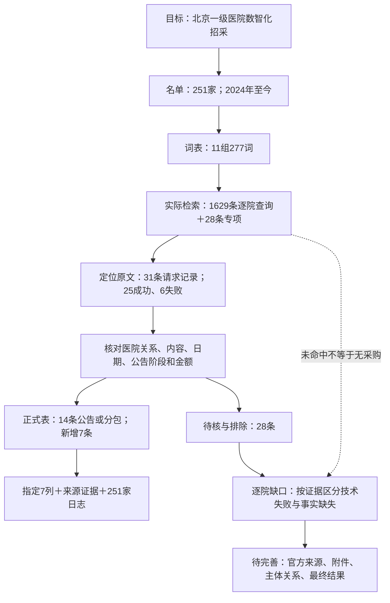

# 想法树 beijing-tier1-tenders-20261027

- 状态：partial
- 创建：2026-10-27T09:47:56+08:00
- 更新：2026-10-27T09:47:56+08:00
- 工具：公开搜索工具 + tender_tools + 现有collection流水线 + 逐条证据核验
- 主题：北京一级医院数智化招采：扩词全名单重跑与证据审计
- 交付：七列CSV/JSON、Excel、逐院检索日志、候选与排除清单、原文证据及采集缺口说明

## 节点

- **requirement** `need`：目标：2024-01-01至2026-10-27，采集名单内医院的医卫数智化招标、中标事实；不做市场规模、客户价值或运营商归属推断。
  - **decision** `scope`：已完成：范围由用户名单确定，03-一级医院共251家，09-招标渠道对照用于渠道参考。
    - **action** `roster`：已完成：保留清单序号、全称、区县、等级、类别、别名及源单元格；客户标签直接沿用名单。
    - **decision** `entities`：已执行：全称与核心院名检索，并对命中线索补查官方别名、上级采购单位；医院用途必须有证据，不自动把研究所或福利院全部采购归入医院。
  - **decision** `keywords`：已完成：新版词表11组、277个去重主题词，另含服务动作与采购阶段词。数字化、数智化不是标题必含词。
    - **configuration** `terms_general`：已配置：综合表述；示例：信息化、数字化、数智化、智能化、智慧医院。
    - **configuration** `terms_clinical`：已配置：诊疗业务系统；示例：HIS、医院信息系统、医院管理信息系统、医疗管理系统、EMR。
    - **configuration** `terms_patient`：已配置：患者服务与远程医疗；示例：预约挂号、分诊叫号、排队叫号、诊间支付、移动支付。
    - **configuration** `terms_insurance`：已配置：医保与支付接口；示例：医保信息系统、医保接口、医保对接、医保改造、医保服务器。
    - **configuration** `terms_operation`：已配置：运营管理系统；示例：HRP、医院资源规划、运营管理系统、精细化运营、财务软件。
    - **configuration** `terms_public_health`：已配置：基层与公共卫生信息系统；示例：基层医疗卫生信息系统、基层卫生信息化、社区卫生信息系统、公卫信息系统、公共卫生信息平台。
    - **configuration** `terms_data_ai`：已配置：数据、接口与人工智能；示例：数据平台、数据中心、数据中台、数据仓库、数据治理。
    - **configuration** `terms_cloud_hardware`：已配置：云、机房与信息设备；示例：云服务、云资源、云计算、云主机、云存储。
    - **configuration** `terms_network`：已配置：网络与通信；示例：专线、互联网接入、互联网出口、宽带、链路。
    - **configuration** `terms_security`：已配置：网络、数据与密码安全；示例：网络安全、信息安全、数据安全、等级保护、等保。
    - **configuration** `terms_smart_facility`：已配置：院内智能管理；示例：弱电智能化、智能化系统、视频监控、安防平台、门禁系统。
  - **action** `search`：已完成：251家每家至少6组基础检索，逐院共1629条真实查询；另28条专项补查单列。全部查询保留原始返回与证据引用。
    - **boundary** `search_limits`：口径：按主题分组查询并对命中内容补查，不是277个词与每家医院逐一穷举；未命中不能解释为没有采购，也不能自动判断为技术爬取失败。
    - **validation** `query_audit`：已完成：逐院1629条查询均在所引用的470份原始执行证据中找到；日志齐全只证明执行范围，不能证明搜索引擎已索引全部公告。
  - **action** `collection`：已执行：从已定位网址生成精确主机白名单和v1任务；先dry-run再执行同一任务，仅运行collection原文归档阶段。
    - **result** `collection_result`：部分完成：本轮4个归档任务合计31条页面请求记录，25条成功、6条失败；页面成功不等于公告符合范围，失败记录保留。
    - **boundary** `access_limits`：已遵守：按robots、域名、请求间隔和页数限制采集；会员遮挡、验证、超时及无文本层等缺口分别记录，不通过换入口规避访问控制。
  - **action** `review`：已完成本批逐条核验：医院关系、实际采购内容、公告日期、阶段、采购包、供应商、金额原句和来源。程序字段校验不替代事实核验。
    - **rule** `amount`：已执行：预算、限价和候选报价不填中标金额；混合项目不推算数智化金额；仅有折扣或单价时成交总额留空。供应商缺失不抹去已明确披露的成交金额。
    - **rule** `dedup`：已执行：医院、公告网址和采购包定位同一公告；跨网址合并由显式决定记录。招标与结果公告分别保留，不把公告行数当独立项目数。
    - **result** `candidate`：待核队列：28条线索或排除记录，原因包括正文受限、日期未核实、医院用途关系不明、缺技术参数、候选非最终结果、时间范围外或废标。
  - **result** `delivery`：已交付：14条公告或分包记录，比上一版新增7条；主表保持7列，附候选表与251家逐院检索记录。
    - **configuration** `columns`：七列：项目名称、产品、招标单位、客户标签、中标单位、中标金额（万元）、来源与追溯。
    - **validation** `delivery_validation`：已完成：核对金额单元格与JSON一致、缺失金额不变为0、证据文件存在、3张工作表无错误单元格，42个来源链接可点击。
  - **next** `next`：待完善：在证据支持范围内补齐缺口，不以提高条数为目标补猜事实。
    - **next** `next_entities`：待完善：逐院确认官网、采购栏目、上级采购主体与历史名称，并保存关联证据；对无命中医院仅标注原因未知。
    - **next** `next_original`：待完善：优先追溯已知公告的官方正文和采购附件；公告只披露目录、候选状态或遮挡字段时维持待核，等待合法可获取的新来源。
    - **next** `next_fields`：待完善：补实际发布日期、数字化技术要求、最终结果及明确金额；扫描附件需在正常访问成功后进行文字识别和人工核对。
    - **validation** `next_code`：已完成：新增参数化tender_audit命令，以输入目录、输出位置和最低查询数执行审计。5项审计测试通过；实际1629条查询留痕和251家日志审计通过。
    - **boundary** `next_coverage`：持续边界：全名单搜索完成、原文抓取成功、字段完整和事实确认是四个不同状态；没有任何单一指标能证明全网完整覆盖。
    - **result** `coverage_audit`：已完成采集缺口审计：12家有保留公告及证据化问题；239家无保留公告，原因未知。逐院清单与原文仅在本地outputs保存。

## 流程图

