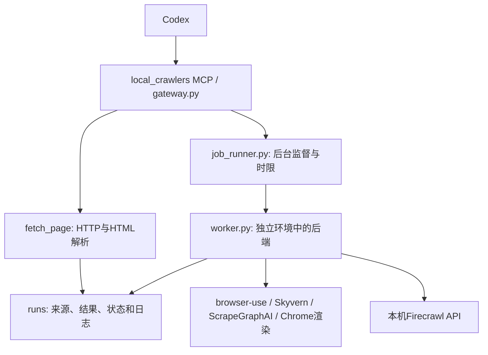

# 本地爬虫智能体与 Harness：代码、能力与部署档案

这是2026-10-27部署工作的归档快照。**归档完成；部署整体仍为 partial**：三个模型后端尚未配置用户指定的 DeepSeek V4.1 Flash，Firecrawl 尚待手动重启后安装容器并验收。执行新任务前以 `crawler_status` 和实际调用为准；本页记录的验收不是未来运行状态保证。

| 入口 | 用途 |
| --- | --- |
| [想法树](tree.md) / [结构化记录](tree.json) | 需求、方案、能力、决策、完成情况、缺口、下一步和原始项目链接 |
| [代码索引](CODE-INDEX.md) / [源文件清单及SHA256](SOURCE-MANIFEST.json) | 按功能找到真实代码副本，并核对来源与完整性 |
| [代码和记录压缩包](local-crawlers-source-and-records-20261027.zip) | 本轮集成源码、依赖快照、说明、验收记录及想法树的便携快照 |
| [任务模板](TASK-TEMPLATES.json) | 六个工具的调用示例和适用场景；模板需补充实际网址再用 |
| [归档校验](ARCHIVE-VERIFICATION.json) | 树结构、文件哈希、ZIP完整性、链接及敏感项排除检查 |
| [原工作总结](artifacts/docs/WORK-SUMMARY-20261027.txt) / [原能力清单](artifacts/docs/TASK-CAPABILITIES-20261027.txt) | 保留本轮已交付的完整文字记录 |

代码实际运行目录为 `E:\CAICTBigData\coding\local-crawlers`。本树的 `artifacts/` 保存独立副本，便于以后源目录变化时追溯。归档内容是本轮编写的集成、部署和验证代码；上游框架通过固定版本的软件包及依赖快照定位，不把整个第三方环境误作自研源码。没有在本轮归档中执行 Git 提交、远程推送或云端发布。

## 1. 需求与已确定的决定

- 网页类型很多，采集程序部署到本机，统一提供给 Codex 使用。
- 选择 browser-use、Skyvern、ScrapeGraphAI、Firecrawl 四个后端；基础读取尽量先用无需后端模型的工具。
- 用户指定模型为 DeepSeek V4.1 Flash，明确稍后配置。供应商实际模型ID、接口地址、密钥、工具调用与图片兼容性尚未确认。
- 代码和独立Python环境迁到E盘；WSL镜像和后续Linux容器数据保留D盘。
- 用户批准现在准备WSL，但明确不自动重启；本轮没有自动重启Windows。
- 复用父项目现有 `idea-trees/<id>/tree.json + tree.md` 体系，使用已有 `scripts/idea_tree_writer.py` 渲染。本次保存详细代码和记录，不改动其他想法树。

## 2. 当前结构与 Harness 到底做什么



本轮自建 Harness 是统一入口和执行外壳：验证参数、检查后端和模型是否准备好、控制默认并发、启动隔离进程、记录输入与状态、限制执行时间、保存结果及日志、校验JSON结构，并让Codex查询。它没有另造一个替代四个框架的“通用智能体”。复杂任务的逐步决策仍由相应上游框架与之后配置的模型完成。

默认同时一个后台任务，默认15分钟；失败明确返回错误，不自动切换到厂商云爬虫。网页文字被视为不可信资料。浏览器按任务新建独立资料目录，不继承用户日常Chrome登录态。程序使用Windows可信证书存储，保持TLS校验；本机回环访问绕过环境代理。远端模型接入后，提交给模型的页面内容会经模型API离开本机。

## 3. 现在可用与尚待验收

| 组件/阶段 | 快照状态 | 本轮验证范围 | 尚未完成 |
| --- | --- | --- | --- |
| MCP统一入口 | 已注册；基础验证通过 | 握手、六工具发现、HTML提取、JS渲染、后台查询、未配模型时明确报错 | 新聊天需重新加载MCP；配置模型后重验 |
| browser-use 0.13.14 | 独立环境安装完成 | 导入、本地Chrome启动、导航和DOM读取 | 模型连续决策和实际采集端到端验收 |
| Skyvern 1.0.56 `[local]` | 嵌入式库安装完成 | 本地运行库、专用Chrome/CDP连接、导航读取 | 模型多步骤任务；凭据、视觉及业务流程验收 |
| ScrapeGraphAI 2.3.1 | 独立环境安装完成 | 核心导入、上游ChromiumLoader读取 | 模型字段提取及多页合并验收 |
| Firecrawl | 配置与系统准备完成，服务未运行 | WSL签名与安装、Windows功能启用、Ubuntu摘要校验 | 手动重启、导入专用发行版、装Docker、启动并验证map/crawl |
| E盘迁移 | 完成，迁移后基础验证通过 | 49,106文件复制校验、92个命令入口重建、4环境依赖检查 | 底层Python仍依赖C盘Codex运行时，不能把venv当完全独立便携包 |

证据文件为 [deployment-status.json](artifacts/evidence/deployment-status.json)、[verification.json](artifacts/evidence/verification.json)、[迁移复测](artifacts/evidence/migration-verification.json) 和 [迁移后依赖检查](artifacts/evidence/migration-dependency-checks.json)。这些是历史报告，本次归档只核验记录和文件完整性，没有重新进行联网采集或调用模型。

## 4. browser-use：需要随页面变化操作的任务

**适合交付：** 搜索、筛选、点击展开、翻页、进入详情、切换标签页后提取信息或下载公开附件。例：从医院采购栏目按关键词找到公告，逐条读取标题、日期、采购人、金额、正文依据和原文链接。

**本地实现：** `worker.py::browser_use_task` 建立 `Browser` 与 `Agent`，配置兼容模型接口，以自然语言任务和起始URL清单驱动执行；`max_steps` 传给Agent。使用本机Chrome、独立 `browser-profile`、任务内 `downloads`，明确 `use_cloud=False`。默认不启用视觉和扩展。

**产物：** `result.json`；`browser-history.json`；下载目录；公共输入、状态和日志。历史成功状态必须通过，否则任务失败。传入schema时在最终结果上检查结构。

**能力边界：** 保存执行历史已接入；当前六个统一工具没有单独的历史重放、文件上传、跨任务登录态管理接口。不能仅根据原项目README就认为这些功能已开放给Codex。模型尚未接入，自动点击/翻页/下载仍未完成本地端到端验收。`max_pages`不构成访问页数硬上限，操作预算用步数和时间约束。

## 5. Skyvern：在一个起点完成多步骤流程

**适合交付：** 在一个网站按流程检索、选择公告类型/年份、打开详情、提取字段或下载。例：进入某省采购站点，选择公告类型，限定时间和关键词，再提取采购人、预算、日期与附件链接。

**本地实现：** `worker.py::skyvern_task` 使用 `Skyvern.local(..., use_in_memory_db=True)`，为每个任务启动本机Chrome，通过仅回环地址的临时CDP端口连接；调用 `run_task`，传入自然语言、唯一的起始URL、schema、步数和时限。模型通过LiteLLM兼容配置连接。

**产物：** `result.json`、`skyvern-run.json`、artifacts及通用日志。只有后端明确completed才接受成功。

**能力边界：** 上游有登录、填表、文件下载及更完整工作流；本地入口目前只暴露run_task。没有装完整Web管理平台，没有命名工作流管理、调度和直播工具。内存SQLite不保存跨任务业务状态。凭据、验证码、视觉和复杂流程仍未验收；不能声称包含上游云端全部反自动化能力。

## 6. ScrapeGraphAI：已知页面中的统一字段提取

**适合交付：** 多个网址已知、排版不一致但字段相同的页面。例：给出医院/机构/项目详情页列表，提取名称、产品、公告日期、原文依据和来源链接；缺失字段留空。

**本地实现：** `worker.py::scrapegraph_task` 单URL使用 `SmartScraperGraph`，多个URL使用 `SmartScraperMultiGraph`；接收提取要求、URL清单和可选schema。浏览器加载器复用本机Chrome，`loader_kwargs`中直接设置 `executable_path`。schema目前加入提示并在任务结束后统一校验，并非强制模型生成时约束。

**产物：** JSON格式结果和通用输入、状态、日志。模型图节点处理网页内容与提取要求，具体字段正确性需核对原文。

**能力边界：** 当前没有接入SearchGraph、采集脚本生成、音频生成、本地文档输入、扫描PDF或OCR。按钮交互交给browser-use/Skyvern。JSON结构通过不等于事实核验通过；多页提取和实际模型兼容仍待验收。

## 7. Firecrawl：发现链接和批量采集原文

**适合交付：** 以一个站点入口发现URL、抓取最多指定数量页面，收集Markdown和来源信息，再由Codex分析。例：抓一个政策库/产品文档站点最多100页，之后筛选主题并整理字段。

**本地实现：** `firecrawl_map` 调用回环地址 `/v2/map`；`worker.py::firecrawl_task` 调用 `/v2/crawl`，传入一个起点、页数limit和Markdown格式，轮询完成后跟随结果分页。后端返回分页地址时仍强制使用本机服务地址，不跟随到托管服务。

**容器方案：** `firecrawl/compose.yaml` 组合 api、playwright-service、Redis、RabbitMQ、PostgreSQL 五项服务，API仅绑定 `127.0.0.1:3002`；队列任务和抓取并发设低值。镜像尚未真实拉取和运行，部分标签为latest，首次成功后须记录/固定digest。

**能力边界：** 当前只接map/crawl。自然语言task不会自动转换为主题、年份或栏目过滤；具体过滤需增加规则或后处理。当前拒绝非空output_schema。官方云Agent、搜索、监控、托管反自动化能力均不计入本地已实现能力。服务尚未启动，因此当前不能安排实际Firecrawl采集。

## 8. 六个Codex工具的准确接口

| 工具 | 主要参数/默认值 | 返回与边界 |
| --- | --- | --- |
| `crawler_status()` | 无 | 安装版本、配置布尔状态、Firecrawl可达性与目录；不返回密钥；配置齐全标记不是模型调用成功 |
| `fetch_page(url, selector="", max_chars=12000)` | HTTP(S)页面，可选CSS区域 | 同步返回标题、正文、来源、最多100个链接；完整正文写result.json；单页HTML最多5,000,000字节；回复正文上限夹在100..50,000字符；不执行JS、不读PDF |
| `render_page(url, timeout_seconds=120)` | 单URL；允许时限30..1800秒 | 后台任务ID；用本机Chrome等待DOM加载及额外1.5秒，保存正文、链接、HTML、整页截图；不自动点击/滚动/翻页；慢加载内容需专门策略 |
| `start_crawl(engine, task, urls, output_schema=None, max_pages=20, max_steps=30, timeout_seconds=900)` | engine四选一；页数1..500、步数1..200、时限30..1800秒 | 后台任务ID；URL数不能超过max_pages；Skyvern/Firecrawl一次只接一个起点；三个模型后端必须先配模型 |
| `job_status(job_id, include_result=True, max_chars=12000)` | 后台16位十六进制ID | 状态、可选结果、结果/日志路径；回复上限100..50,000字符，超出为预览，完整结果仍在文件中 |
| `firecrawl_map(url, limit=100)` | limit夹在1..1000 | 本机服务原始JSON；服务未启动即报错；没有托管兜底 |

`fetch_page`的fetch-*目录没有后台state，直接使用同步返回的 `saved_result`；不要把它当16位后台job_id再交给job_status。URL检查只保证HTTP(S)、有主机且无内嵌凭据，没有自动实施父研究项目的来源域名白名单、robots规则或证据核验规则。正式研究须继续遵守父项目规则，并按任务控制来源和范围。

## 9. 任务预算、输出及如何安排任务

先查状态，再按复杂度选择：普通HTML→fetch_page；JS内容→render_page；已知页面统一字段→ScrapeGraphAI；不确定交互→browser-use；单站流程→Skyvern；批量站点原文→Firecrawl。后四项受前述待配置/待启动状态限制。

任务至少提供：目标、起始URL/来源清单、域名/栏目范围、关键词和时间口径、字段、页数或记录数目标、操作步数、时限、交付格式，以及是否保留正文/附件。缺失字段留空，事实保留原文链接和依据。年份条件应区分发布日期、事件日期和抓取时间。

`max_pages`只硬约束Firecrawl的limit和输入URL数量；对browser-use/Skyvern不保证实际只访问这些页数。若要严格的域名、深度、请求频率、去重和累计页数管理，需要显式扩展适配器，当前不能靠一句提示当强制保证。

后台任务保存在 `E:\CAICTBigData\coding\local-crawlers\runs\<job_id>`：`input.json`、`state.json`、`supervisor.json`、`supervisor.log`、`worker.log`、成功时的 `result.json` 及后端额外产物。状态queued/running/completed/failed；超时任务失败并尝试清理worker进程树。当前没有统一取消工具和崩溃后遗留running状态的自动修复；若显示一直有活动任务，先核实进程与日志，不能直接删锁或改状态强行续跑。

基础交付是JSON、正文或Markdown，CSV/Excel由Codex后处理。周期任务、代理池、通用OCR、跨任务登录态复用和验证码处理均尚未接入。不能把采集器的“成功”当作事实已证实、站点已全覆盖或研究阶段已完成。

## 10. 版本、目录及恢复定位

| 内容 | 快照位置/版本 |
| --- | --- |
| 部署代码/环境/配置 | `E:\CAICTBigData\coding\local-crawlers` |
| Gateway Python | `E:\CAICTBigData\coding\local-crawlers\envs\gateway\Scripts\python.exe` |
| 顶层固定包 | mcp2.3.0 / httpx0.28.1 / beautifulsoup4 4.15.0 / psutil7.2.2 / truststore0.10.5 |
| 三个框架 | browser-use0.13.14 / skyvern[local]1.0.56 / scrapegraphai2.3.1 |
| 底层共享Python | `C:\Users\Jane\.cache\codex-runtimes\codex-primary-runtime\dependencies\python\python.exe` |
| Chrome | `C:\Program Files\Google\Chrome\Application\chrome.exe`，由CHROME_EXECUTABLE配置 |
| Codex MCP配置位置 | `C:\Users\Jane\.codex\config.toml`，只归档本组件的空密钥配置示例 |
| WSL安装/系统记录 | [host-setup-status.json](artifacts/evidence/host-setup-status.json)；WSL3.0.3安装退出0、微软签名Valid |
| Ubuntu镜像 | `D:\CodexLocalCrawlers\installers\ubuntu-24.04.5-wsl-amd64.wsl`，SHA256见[记录](artifacts/evidence/ubuntu-image.json) |
| 专用发行版及未来数据 | CodexCrawlers / `D:\CodexLocalCrawlers\WSL\CodexCrawlers` |
| 旧兼容入口 | C盘旧work目录及lcrawl-20261027只为目录联接，实际代码位于E盘 |

迁移复制了49,106个非pyc文件、1,688,429,339字节，排除了未使用的uv启动工具；记录中missing/mismatches均为空。迁移后重建gateway9、browser-use30、ScrapeGraphAI18、Skyvern35，共92个命令入口。原始迁移前记录保留在部署目录的 `migration-history/20261027-before-move`；本树保留关键迁移报告，不复制整套运行缓存和历史网页。

源代码快照不含venv、上游完整源码仓库、浏览器安装、MSI或Ubuntu大镜像。恢复时解压本归档的 `artifacts/code/` 到目标代码目录，按依赖快照查版本，运行Install创建独立环境，再注册MCP。`Install.ps1`固定顶层包但不会自动按freeze锁定全部传递依赖；四份lock是本次已测版本记录，若未来依赖变化应重新核验。更换电脑须显式设置实际BasePython和Chrome路径；WSL/D盘路径也需要相应调整。历史验证脚本/报告是验收依据，恢复时还要检查其中的工作目录假设。

真实 `.env`、密钥、数据库随机密码、Cookie、浏览器资料目录、全局Codex完整配置均不在归档中。运行 `.env.example` 的空模板并不意味着已有可用模型；秘密值通过环境变量传入。模型接入时仍须设置Codex MCP环境透传。底层读取逻辑只覆盖模板中已有的键，恢复时保留模板键名。

## 11. 继续工作的步骤与验收标准

**A. 用户手动重启后完成Firecrawl**

```powershell
Set-Location -LiteralPath 'E:\CAICTBigData\coding\local-crawlers'
powershell -File .\Complete-FirecrawlWSL.ps1
# 之后常规启动/停止；停止不删数据卷。
powershell -File .\Start-Firecrawl.ps1
powershell -File .\Start-Firecrawl.ps1 -Stop
```

归档时尚未运行上述继续步骤。继续脚本校验Ubuntu摘要、导入专用发行版、安装Docker/Compose并启动容器；不重启Windows。不需要再次运行已完成的Configure-WSLHost来覆写历史状态。若同名发行版已存在但无本部署所有权记录，脚本会停止，须先核实归属。

验收应包括专用发行版可启动、Docker/Compose可用、五服务健康、本机API可达、map返回URL、限制几页的crawl成功并保存Markdown，记录实际镜像digest及失败日志。只有通过这些验证才能把Firecrawl状态改为可用。

**B. 用户准备配置模型时接入DeepSeek**

核实供应商实际ID、兼容接口、模型上下文、工具调用、JSON输出及图片支持；不能把“DeepSeek V4.1 Flash”这个需求名称直接当作已核实API模型ID。非敏感参数写配置，密钥只通过进程/系统环境传入；设置MCP透传并重新加载。默认保持MODEL_SUPPORTS_VISION=false，直到真实验证支持图片。

分别执行小规模任务验收：browser-use一次搜索/点击/提取并检查历史；Skyvern一次筛选/详情/提取并检查完成状态；ScrapeGraphAI单页+多页字段提取并核对原文与schema。保留模型调用是否发生、输入/输出、错误和实际费用/时限信息；不要把导入成功等同模型兼容成功。

**C. 之后若用于正式研究流水线**

当前本组件是独立MCP后端，尚未接入父项目版本1任务协议。后续再设计来源白名单、累计预算、研究证据字段、去重、恢复和核验接点；不要假定当前adapter已具备父流水线全部约束。相关规范见父仓库 `docs/GPT_RESEARCH_GUIDE.md`、`docs/COMMANDS.md`、`docs/DATA_DICTIONARY.md`。

## 12. 原项目与继续查找的关键词

| 项目 | 原仓库 | 当前采用方式 |
| --- | --- | --- |
| browser-use | [browser-use/browser-use](https://github.com/browser-use/browser-use) | pip包0.13.14 + 本机Browser/Agent |
| Skyvern | [Skyvern-AI/skyvern](https://github.com/Skyvern-AI/skyvern) | pip包1.0.56 local嵌入式运行 |
| ScrapeGraphAI | [ScrapeGraphAI/Scrapegraph-ai](https://github.com/ScrapeGraphAI/Scrapegraph-ai) | pip包2.3.1 + SmartScraperGraph/MultiGraph |
| Firecrawl | [firecrawl/firecrawl](https://github.com/firecrawl/firecrawl) | 自托管预构建镜像 + 本机map/crawl适配器，尚未运行 |
| WSL | [微软WSL 3.0.3发布](https://github.com/microsoft/WSL/releases/tag/3.0.3) | 已安装，等待Windows手动重启 |
| Ubuntu | [Ubuntu 24.04.5 WSL镜像](https://releases.ubuntu.com/24.04.5/ubuntu-24.04.5-wsl-amd64.wsl) | 已下载并核对SHA256，尚未导入发行版 |

本页按已安装版本、当前代码和本轮记录归档；没有再次验证上游未来版本的产品能力。检索关键词：本地爬虫、爬虫智能体、爬虫Harness、local_crawlers、MCP、browser-use、Skyvern、ScrapeGraphAI、Firecrawl、DeepSeek V4.1 Flash、E盘迁移、CodexCrawlers、WSL、不自动重启、医院采购、能力清单、源代码、验收记录。
