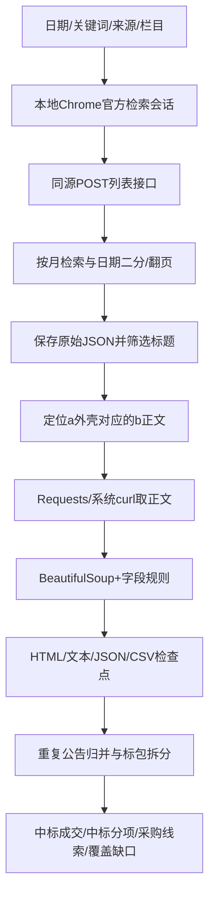

# 技术方案与跨项目复用手册

记录时间：2026-10-28T14:42:31+08:00。生产分支：feat/national-ggzy-medical-digital。解析器版本：6。状态：partial。

## 1. 本轮实际使用的技术

| 层 | 实际技术 | 在本轮解决什么问题 |
|---|---|---|
| 浏览器检索 | Playwright 1.64.0 + 本机Chrome 149.0.7827.197 | 打开官方检索页，在正常页面会话中执行同源fetch，取得列表JSON |
| 正文取页 | Requests 2.34.2，Windows curl 8.13.0/Schannel | 获取全国平台真正的正文HTML；TLS/连接异常时使用已校验证书的系统取页路径 |
| 证书信任 | truststore 0.10.5 | 将Windows系统信任链接入Python SSL；浏览器ignore_https_errors=False，未关闭证书校验 |
| HTML解析 | BeautifulSoup 4.15.0 + Python html.parser | 定位正文、识别表格列、提取标的/采购人/供应商等文本；处理布局表和嵌套表 |
| 采集调度 | Python 3.11.17、asyncio、asyncio.to_thread、argparse | 浏览器异步流程；同步Requests放在线程中执行，但主流程仍按请求节流，不是并发扫站 |
| 检查点与证据 | JSON、UTF-8 BOM CSV、SHA256、原子替换 | 保存窗口、页码、候选、记录、历史失败、文件来源；支持resume及原文重解析 |
| 本机批次监督 | Node.js v24.22.1 child_process + PowerShell隐藏启动 | 启动有上限的批次、记录真实PID/日志、切换两个采集阶段和更新表格 |
| Excel | @oai/artifact-tool 2.8.106 | 生成工作表、数值金额、日期、筛选、冻结与预览；交付前检查结构及错误 |
| 原生链接补齐 | Python标准库zipfile + ElementTree | 当前运行时HYPERLINK未实现，只给导出的OOXML补链接，不重写表格内容 |

主链路不调用LLM，也不需要DeepSeek密钥。HTTPX/lxml虽然已安装，但不是这个采集器核心代码的必需依赖。browser-use/Skyvern/ScrapeGraphAI/Firecrawl未用于本批生产采集；本案例复用已有Playwright和共享取页/解析代码。全国平台采集模块目前通过CLI由Codex调用，没有新增专用MCP工具。

## 2. 从检索到表格的链路



真实请求入口是 https://www.ggzy.gov.cn/deal/dealList.html；列表为POST /information/pubTradingInfo/getTradList。表单使用DEAL_CLASSIFY、DEAL_STAGE、SOURCE_TYPE、DEAL_TIME=06、TIMEBEGIN、TIMEEND、FINDTXT、PAGENUMBER。实际返回code 200有保存的JSON；早期直接请求的404和历史接口结束时间错误仍留在旧任务。正常浏览器会话与早期直连结果不同是观测结果，具体网关/WAF规则没有被完整证明。

源码从官方前端和实际iframe确认：/information/deal/html/a/是详情外壳，正文使用/html/b/。该路径变换只适用于已确认的全国平台页面，不能照搬到其他网站。正文虽可标text/plain，内容实际是HTML，按已验证的站点契约处理。

来源枚举：1省平台、2央企招投标、3财政部、4自然资源部、6商务部。本次更正财政部为3；原source4任务单独保留。政府采购用02和0202/0201；工程建设用01和0104/0101。财政部0201的通用“公告信息”中也会有结果公告，因此用明确结果标题辅助判断，不能只看栏目编号。CLI列出23/90不代表这些类别已完成验证。

## 3. 复用方式与要改的地方

**同一全国平台的新任务：**复用入口和取页代码，明确新日期、关键词、来源、栏目、输出目录及预算。改日期/关键词/来源范围要另建任务；成功缓存只在相同配置下resume。新项目领域还需改HEALTH/STRONG/PHYSICAL/SOFTWARE和标签规则，并增加离线及少量真实验证。

**不同采购网站：**复用金额转换、证据归档、表格生成思路和检查点模式；重新勘察列表接口、登录/会话要求、栏目含义、分页上限、详情地址和表格选择器。保留新站点自己的抓取器，先拿一份真实公开样本验证。修改bid_common会影响央采/北京/雄安等已有采集器，优先站点局部覆盖或新行业模块。

**其他操作系统/另一台电脑：**需要提供Python、Playwright、已有Chrome和四项Python依赖；national_ggzy.py内的Chrome路径、run_collection.mjs的repo/root/python/node/PATH/日期/阶段、build.mjs的runDir/outDir/日期文案/原生链接Python路径都需要调整。不能把Windows证书/curl/Conda路径当作跨平台配置。包内不附带运行环境。

**只需要数据，不需要原样Excel：**采集器直接产出公告明细.csv及state.json，不依赖artifact-tool。原样Excel仍依赖Codex桌面的artifact-tool及相应Node/Python运行时；包内没有该专有运行时，不保证在任意裸Node环境可直接npm安装后运行。

这个入口是站点专用CLI，不是统一health_deployment版本1任务JSON；request.json是范围记录，不能直接传给run-local.ps1 task --spec。job.json是本机批次状态文件，不是互斥锁。

## 4. 最小使用示例（先离线校验，联网另行执行）

在原仓库根目录或解压后的artifacts/code目录运行。以下目录名为新任务示例，运行前确认没有同名任务。依赖已具备时，无需再次安装或下载浏览器。requirements-collector.txt只记录已验证版本，不自动执行安装。

```powershell
$python = 'D:/Anaconda3/envs/BigData/python.exe'
$env:PATH = 'D:/Anaconda3/envs/BigData/Library/bin;D:/Anaconda3/envs/BigData;' + $env:PATH
$env:PYTHONIOENCODING = 'utf-8'
& $python -B -m pipeline.research.national_ggzy --start 2026-10-21 --end 2026-10-28 --keywords 医院 --sources 1 --business 02 --notice-types 0202 --output E:/CAICTBigData/coding/outputs/ggzy-reuse-example-new --max-api-calls 5 --max-details 10 --dry-run
```

确认范围与预算后，对同一个新任务删除--dry-run参数执行；这一步会联网。dry-run只校验日期/节流/预算和计算初始窗口，不证明浏览器、证书或网络正常。原任务续跑用完全相同的范围并加--resume，不能同时启动同目录的两个采集进程。--max-api-calls是本次调用预算；--max-details是该目录累计详情请求上限。网络重试也可能产生底层额外尝试，计数不是逐包HTTP总量。

```powershell
# 离线重解析已有正文：仍须先确认该目录没有存活采集进程
& $python -B -m pipeline.research.national_ggzy --output E:/CAICTBigData/coding/outputs/ggzy-reuse-example-new --start 2026-10-21 --end 2026-10-28 --keywords 医院 --sources 1 --business 02 --notice-types 0202 --resume --stage reparse
# 入口解析回归（快照包含22项）
& $python -B -m unittest discover -s tests -p test_national_ggzy_collector.py -q
```

--stage discover只做列表、--stage details处理已发现正文、--stage reparse只读已保存正文。--retry-failed仅在失败原因已处理后显式使用；它不是绕过验证码的开关。同步取页默认不继承本地代理，如需本来授权的代理，在启动进程前设置SITE_FETCH_USE_PROXY=1；不能把切代理写成自动绕过访问限制的步骤。

## 5. 字段、金额与覆盖口径

九项字段：项目名称、产品、招标单位、客户标签、中标单位、运营商类型、中标金额（万元）、场景、相关网页。额外保留公告日期、公告类型、省份、项目编号、金额原文、信息缺口和标签依据。

实体和标的从原文取；缺失或不可靠就留空。客户、运营商和场景是名称/标题规则标签，不是人工核验或企业股权穿透结论。“非运营商”仅表示名称规则未识别。医学教育/科研机构也可能进入广义线索，需要按项目研究口径复核。标题筛选会漏掉只在正文出现的医疗/数字化内容，也可能保留广义机构IT线索。

只将明确中标/成交金额换算为万元，预算、报价排名、单价、折扣和百分比不当总额。候选人公示、更正、终止及采购公告不填最终中标事实。多标包无明确总额时主表金额留空，分项表逐条留金额；产品未自动匹配到分项，留空待核，主表和分项不可相加。自动重复归并保留evidence_ids及所有URL，公告数不是去重项目数。

## 6. 检查点、故障和恢复经验

- **列表1000条上限：**先按月，再递归二分日期。单日仍达1000时停止，需要实现进一步来源/地域细分；这部分没有实现。
- **限流和验证码：**每次显式请求至少间隔3.2秒；HTTP 401/403/429或code 829/800会停止，不自动解验证码。列表fetch设45秒AbortController；失败响应与重试尝试各自保留。
- **TLS：**启用系统信任，保留证书校验；Requests失败按site_fetch的系统curl路径处理，连续证书失败会停止。不能用verify=False恢复。
- **嵌套表格：**只按tr最近的table解释列，过滤页布局表；产品排除表头、品目号、联系方式及畸形长尾。上述问题均有离线回归。
- **进程与预算：**监督器每15秒读检查点，最多12轮、每阶段每批500次检索、每阶段累计6000次详情。达到预算留下窗口后进入后续批次；无跨进程互斥锁和操作系统崩溃自动恢复。所有启动都要先核实旧PID和输出目录。
- **人工暂停：**在运行阶段目录创建pause.request，等待检查点及真实进程退出；归档旧job和日志后，再处理自己创建的暂停控制文件并恢复。不要删除任务锁强行继续。
- **Excel被占用：**本次发现~$工作簿锁文件，os.replace报WinError 5。采集仍推进，最后成功Excel和delivery-dataset.json可能落后于state.json/CSV；job.last_export_error可定位。用户关闭占用该文件的Excel后，后续有新记录或阶段结束时可重试。不要强制关闭用户应用或删除~$锁。当前没有已验证的锁定自动旁路导出功能。
- **刷新时间：**180秒是最小导出间隔，还需记录数变化触发，不是严格每180秒一次；Excel被占用或生成失败时不会保证最新。生成单独临时文件后原子替换，旧的有效交付仍保留。

## 7. 已验证内容与仍需完成

原仓库22项采集器回归和11项旧脚本回归合计33项已通过；本快照单独带22项核心采集器测试。真实网络已取得列表及正文，三个样本含可核对的金额单位转换。Excel曾逐项核对九列、原生URL、数值金额、日期范围、非结果空中标事实、ZIP完整性并查看四页预览。每次字段或布局变更仍需重查，不能把旧验证声明当作未来导出自动认证。

归档的首次独立预检发现zycg还有fetch、tenders、config三项传递依赖，随后一起补入快照。最终检查直接在artifacts/code中运行，导入路径指向快照本身，避免误用生产仓库造成“看似可复用”。每次归档会保存REUSE-VERIFICATION.json；预检未通过时停止打包。

截至本快照，政府采购与工程建设范围仍为partial；工程队列以job.json为准。尚缺未处理窗口、单日上限进一步细分、标包级产品映射、实体/金额缺口补核、跨站适配和独立项目归并核验。没有实现通用全自动任意网站采集、登录验证码处理、LLM字段补核或全量覆盖证明。

实时原始记录：E:\CAICTBigData\coding\outputs\national-ggzy-medical-digital-2026-20261028\collection-v2。成功工作簿目录：E:\CAICTBigData\coding\outputs\01a17c0d-96d1-79a3-9665-f4fc255ee0c7。本树提供代码和三份公开样本，完整原文/解释器/虚拟环境未全部打包。
